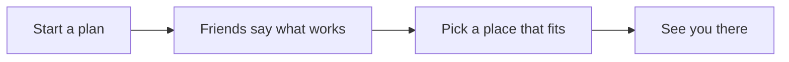
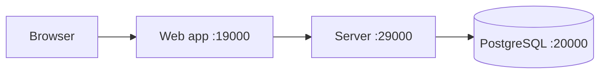

# Hangelo

**Less planning. More hanging out.**

Hangelo turns your friends' different schedules, budgets, interests and locations into one confirmed
plan. Not another group chat, not another calendar: just the plan.

Try it: https://meet-again-ui-112b5408b3d1.herokuapp.com/

## Why

We talk to our friends all the time and see them far less. Plans die in the details: someone says
"we should hang out", and then comes the thread about when, where, how far and how much. By the
time it is settled, half the group has lost interest.

Hangelo asks each person once and puts the answers together.

## How it works



1. **Start a plan.** Say what you feel like doing, offer a few dates and send the link to your
   friends. It takes a minute.
2. **Everyone says what works for them.** Whether they are coming, where they are coming from and
   how far they will travel. Once, instead of in dozens of messages.
3. **Pick a place that fits.** Hangelo suggests places everyone can reach and that fit the budget.
   Talk it over in the plan's own chat.

## What you can do

| | |
|---|---|
| **Plan something** | Choose an activity: dinner, coffee, a bar, a walk, cinema, sport, board games, a bathhouse or anything else. Distance and budget are filled in for you; change what does not fit. |
| **Invite by link** | Send one link. Friends without an account can open it, sign up and join. |
| **Offer several dates** | Propose more than one time for the same plan. |
| **Get places suggested** | Up to three places chosen from where everyone is coming from, how far they will travel and the budget. |
| **Chat about the plan** | Every plan has its own chat with the people in it, with unread counts and messages that arrive live. |
| **Open a plan to everyone** | Make a plan public and it appears in the feed. Others ask to join, and you approve or decline. |
| **Keep friends close** | Friend requests, a friend list, and profiles with photos, interests and a few words about yourself. |
| **Stay in the loop** | Notifications in the app, and e-mail reminders before a plan starts. |

It works on a phone and on a wide screen, in a light and a dark theme.

## Coming next

- Tell friends in another city that you are visiting, and plan to meet while you are there.
- Real places on the live site: the suggestions there are empty until places are loaded.

## Run it yourself

Hangelo is two repositories: this one (the server) and `meet_again_ui` (the web application).



**Server.** You need Docker, JDK 25 and `make`.

```bash
make start
```

This starts the database, prepares it, loads demo data and runs the server.

**Web application.** You need Node 22.18 or newer. In the `meet_again_ui` repository:

```bash
npm install
```

```bash
npm run dev
```

Open http://localhost:19000 and log in as `alice@demo.test` with the password `demo123`. Alice has
three friends, a friend request waiting, and a plan with a chat. `bob`, `carol`, `dan` and `eve`
have accounts too, with the same password.

| Command | What it does |
|---------|--------------|
| `make test` | Runs all server tests |
| `make stop` | Stops the database, keeps the data |
| `make recreate` | Wipes the local data and builds everything again from zero |

## More

- Every piece of work, with what was built and what was checked: [doc/plans](doc/plans).
- Project rules, ports and conventions: [CLAUDE.md](CLAUDE.md).
- Every `make` target: [Makefile](Makefile).
